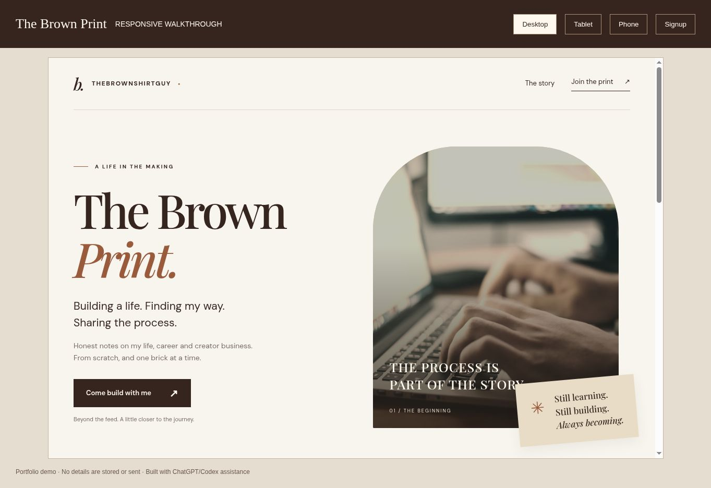

# The Brown Print

Two responsive designs for the same newsletter brief by Marvin, developed with ChatGPT/Codex assistance.

## Why I built this

My brother, known on social media as TheBrownShirtGuy, wanted an email audience so he could stay connected with followers even if he lost access to a social account. After seeing the newsletter page he created with a website service, I challenged myself to build an alternative.

I built the initial HTML/CSS page and kept revising it around his specific feedback about layout and presentation. When I got stuck, I asked my instructor for guidance with styling and troubleshooting, sometimes showing the page to explain the problem. I took a break when frustrated, returned with new ideas, and continued improving the design.

The result is one project explored through two visual approaches. My experience included building the initial page, working through feedback, debugging and iterating. Later implementation, testing and portfolio preparation also involved AI assistance. The educational stages below were reconstructed later and are not a historical record of these iterations.

### What this experience demonstrates

- Translating a real person's audience needs into a website brief.
- Revising a design in response to specific feedback.
- Seeking instructor guidance and applying it to practical problems.
- Persistence through debugging and returning to improve earlier work.
- Exploring two layouts for the same goal, rather than presenting them as unrelated projects.

### Current outcome

Two public frontend demos and reviewable backend/dashboard source. Email delivery is not yet configured and verified. No production audience, business impact or subscriber-growth results are claimed.

## One project, two design approaches

- **Editorial Design:** editorial split layout, warm cream surfaces and a story-led presentation.
- **Stacked Design:** stacked layout, dark brown surfaces and a focused signup card.

[Compare both designs](https://marvericklnk.github.io/the-brown-print/designs.html) · [Editorial Design](https://marvericklnk.github.io/the-brown-print/) · [Stacked Design](https://marvericklnk.github.io/the-brown-print/design-02/)

Stacked Design has a separate [local Node/Express implementation](design-02/) with welcome-email and owner newsletter dashboard code. Its public demo sends no email and stores no signup data. Real email delivery is not verified.

[Live demo](https://marvericklnk.github.io/the-brown-print/) · [Responsive preview](https://marvericklnk.github.io/the-brown-print/showcase.html) · [40-second walkthrough](media/walkthrough.mp4)



## Try it

The public GitHub Pages version is a **frontend demonstration**. Enter sample details only: it validates the form and opens a demo confirmation page, but does not create a subscription or send emails.

The original local Express version (`server.js`) saves signups to a private JSON file without sending email. The separate stacked-design backend includes email and dashboard code; real email delivery still needs configuration and testing.

## Development, layer by layer

These stages were **reconstructed from the completed design for learning and review**. They are not a backdated record of original development. The commits are made now and show the implementation in a readable order.

| Stage | Files | What changes |
| --- | --- | --- |
| 01 — Structure | [HTML](stages/01/index.html) | Headings, paragraphs, labels and a form, without styling. |
| 02 — Visual design | [Design](stages/02/) | Brown-and-cream palette, typography, image treatment and desktop layout. |
| 03 — Responsive layout | [Responsive](stages/03/) | Breakpoints, stacked columns and smaller spacing for narrow screens. |
| 04 — Interaction | [JavaScript](stages/04/script.js) | Form validation, visible errors and a demo thank-you page. |
| 05 — Local backend | [Server](server.js) | Express endpoint, duplicate checks and serialized file writes. |

## Run the full local version

Requires Node.js and npm.

```bash
npm install
npm start
```

Open http://localhost:3000. Use the Node server rather than Live Server for the backend version.

## Project map

- `public/`: actual frontend that calls `/api/signup`.
- `server.js`: local signup API and static server.
- `docs/`: public demo; no data collection.
- `stages/`: educational snapshots.
- `media/`: website screenshots and a short captioned walkthrough.

## Technical decisions

- CSS Grid handles the main two-column layout; media queries stack it on smaller viewports.
- A shared stylesheet keeps the landing and thank-you pages consistent.
- Real labels, focus outlines and live error messages support keyboard use.
- The server validates again, lowercases emails and rejects duplicates.
- File writes are queued and use a temporary file plus rename to avoid overlapping writes in one Node process.

## Limits

JSON storage is for this single-process learning project. Before collecting real subscriptions, use a database, an email provider, suitable consent/privacy information and abuse protection. No email delivery, subscriber login or production newsletter service is claimed.

`subscribers.json` and `.env` are excluded from version control. Never upload real subscriber data.

Fonts load from Google Fonts and the workspace photo is hosted on Unsplash. Fallback fonts and background colours remain available when those services cannot load.

